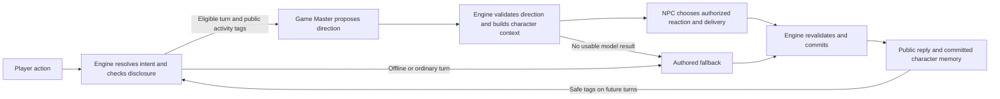

# AI architecture review

22 November 2026 · Detective Game with AI Agents · Review and proposal

**Decision after review.** The project owner approved the early-E pilot as E1. E2 owns the full Greyhaven content and both discovery routes. F owns accusation outcomes and end-to-end verification. The [E1 proposal](../openspec/changes/greyhaven-agent-coordination-pilot/proposal.md) defines the scope awaiting implementation approval. A subsequent GitHub check confirmed Homework 10 PR #21 merged at `e578de4` and zero open PRs. The historical workflow notes below describe the earlier audit.

## Executive summary

The game has a deterministic investigation director and stateful, AI-assisted characters. With a model configured, the model can select how a character delivers testimony the engine has already authorized. Character personality, memory and relationships already matter, but their current effects come from authored content and engine rules. There is no Game Master model call, and NPCs have no independent model-driven goals or information exchange. The project has moved toward tightly controlled performance selection while retaining substantial foundations for the original concept.

Add a small, optional model-based Game Master at the start of E and prove it with two existing Greyhaven preview characters. Let it choose a bounded interview direction based on public investigation events and carry an approved direction across two turns. Give each NPC its own projected context and let it choose a permitted reaction and delivery within that direction. Preserve exact authored testimony and keep both E discovery routes and F endings fully playable offline.

## Current architecture and evidence

The browser sends actions to the Node API. The CLI uses the same investigation engine directly. Both normal entry points configure the same optional performer, passed through the case registry to each investigation. The registry defaults to full Ashcroft and also publishes the two-character Greyhaven repair-dispute preview. The preview has its own validated disclosure policy, evidence and facets. It has no full-case solution or verdict. The full Greyhaven package and case-specific ending are plans. Ashcroft uses the original catalog and deterministic evidence-aware conclusions. [server.js](../src/server.js), [cli.js](../src/cli.js), [registry.js](../src/cases/registry.js), [validate-package.js](../src/cases/validate-package.js), [Ashcroft](../src/cases/ashcroft.js), [Greyhaven preview](../src/cases/greyhaven-preview.js), [mystery-conclusion.js](../src/mystery-conclusion.js).

**Director authority.** `createInvestigation` owns room and lifecycle checks, public projections, evidence receipt and submission of accusations. `resolveDialogue` resolves text and eligible choices to an authored plan. `coreAllowed` and, for v2 catalogs, `policyCoreAllowed` enforce speaker ownership and disclosure. `policyPlan`, `currentPolicyCore`, `resolveFacet` and `stagePolicy` implement gated disclosures, account revisions and contextual clarification. Rules can depend on received testimony across characters. This is authored coordination through the investigation state, with zero directing model calls. [game.js](../src/game.js), [dialogue-state.js](../src/dialogue-state.js), [dialogue-policy.js](../src/dialogue-policy.js).

**Character state.** `initialDialogueState` creates one NPC state entry per profile in each investigation. `prepareTurn` stages eight recent substantive turns, a last-core pointer, discussed and presented IDs, bounded repeat counts, gestures, and cooperation, irritation and tension. `applyPerformance` records delivery choices and pacing, and `cachePerformance` caps the per-NPC cache at 64 entries. The model can indirectly affect later surface delivery through that history. NPC state survives turns in an active session. API sessions are in memory and expire, and there is no save/resume or provider-side conversation. Greyhaven has authored known facts, beliefs, concealment and motivations, such as Mara's protectiveness and Owen's desire for independence. These explain specific testimony and gates. There is no simulated goal pursuit or general social graph. [dialogue-state.js](../src/dialogue-state.js), [authored-performances.js](../src/authored-performances.js), [investigation-sessions.js](../src/investigation-sessions.js), [Greyhaven preview](../src/cases/greyhaven-preview.js).

**Provider.** `createConfiguredNPCPerformer` needs both `OPENAI_API_KEY` and `OPENAI_MODEL`. `createOpenAINPCPerformer` makes a Responses API request with strict JSON, `store: false`, an eight-second default timeout and no retries. It receives character-specific style, demeanor, resolved intent and one to four eligible narration/dialogue pairs. It receives no raw question, full transcript, private fact annotations or solution. Each eligible cache miss has its own request, with a shared adapter and configured model. No NPC runs in the background or independently chooses what testimony to offer. Unconfigured or failed requests use local fallbacks. The trusted legacy phraser injection and historical live phrasing experiment predate this normal runtime path. [npc-performance.js](../src/npc-performance.js), [dialogue-phraser.js](../src/dialogue-phraser.js), [phrasing experiment](../openspec/changes/measure-real-model-phrasing/proposal.md), [safe NPC performance spec](../openspec/specs/safe-npc-performance/spec.md), [exact-output security history](security/issue-3-knowledge-leak-protection.md).

### Milestone and verification status

| Stage | Evidence and status |
| --- | --- |
| A | Merged in PR #14 (`3727a9b`). Case factory, session identity and case selection are implemented. Preview publication came later. [A report](multi-case-foundation/implementation.md) |
| B | Merged in PR #15 (`37d7b26`). Deterministic disclosure and atomic account revisions implemented. [B report](deterministic-disclosure/implementation.md) |
| C | Merged in PR #16 (`2003b1b`). Statement-specific, bounded clarification implemented. [C report](statement-specific-clarification/implementation.md) |
| D | Merged in PR #17 (`16d6992`), present in review HEAD. Older D report and roadmap handoff text still describe a pending merge. [D report](greyhaven-preview/implementation.md), [process preflight](../PROCESS.md) |
| E and F | Proposed and unstarted in the reviewed code. E authors the complete case and proves both discovery routes. F implements supported/partial/incorrect conclusions and gates full publication on end-to-end verification. [Staged roadmap](../openspec/changes/design-relationship-driven-mystery/greyhaven-implementation-roadmap.md) |

OpenSpec still lists the completed A–D changes and the completed relationship-driven planning change. Task completion there tracks each change's own scope. The durable dialogue specs cover the hybrid UI, stateful dialogue, naturalness, safe performance and mystery deduction. The reviewed suite re-ran 386 targeted tests with Node's process isolation disabled. All passed. The default npm test command hit Windows sandbox `spawn EPERM`. The replay below used the real engine and a local performer stub. The evidence for provider behavior comes from source and stubbed adapter tests. [OpenSpec specs](../openspec/specs), [performer tests](../test/npc-performance.test.js), [transaction tests](../test/disclosure-transactions.test.js), [clarification tests](../test/clarification.test.js), [preview tests](../test/greyhaven-preview.test.js), [preview browser tests](../web/e2e/greyhaven-preview.spec.js).

## Original vision versus implementation

| Intended feature | Current implementation | Repository evidence | Gap | Final-project priority |
| --- | --- | --- | --- | --- |
| Game Master coordination | Deterministic orchestration and authored cross-character prerequisites | [Engine](../src/game.js), [policy](../src/dialogue-policy.js) | No model-driven direction or cross-turn instructions | High |
| NPC autonomy and goals | Shared selector with separate turn contexts. Motivations represented in authored profiles and testimony | [Performer](../src/npc-performance.js), [preview](../src/cases/greyhaven-preview.js) | Add one meaningful, bounded local choice under a character goal | High |
| Character memory | Separate session state and semantic receipts | [State](../src/dialogue-state.js) | Project safe memory into NPC decision context. Durable saves are optional | High |
| Relationships | Public dossier links and authored motives influence omissions and accounts | [Preview](../src/cases/greyhaven-preview.js), [policy](../src/dialogue-policy.js) | No live relationship model. A reviewed public relationship can inform direction | Medium |
| Knowledge management | Speaker-scoped authored cores, evidence and receipt checks, exact-output validation | [Policy](../src/dialogue-policy.js), [transactions](../test/disclosure-transactions.test.js) | Keep this authority and apply it to every new projection | Essential |
| Personality | Authored voices, mannerisms and deterministic demeanor | [Catalog](../src/data/dialogue-catalog.js), [performances](../src/authored-performances.js) | Give characters distinct choices where the current pool offers little variation | High for pilot |
| Player adaptation | Local reactions to repetition, pressure, respectful wording and evidence | [State](../src/dialogue-state.js) | No player-style prediction or session-level strategy. Add recent action tags for direction | Medium |
| Natural dialogue | Typed questions, deterministic intent and facets, authored alternatives and optional model selection | [Classifier](../src/question-classifier.js), [state](../src/dialogue-state.js), [performer](../src/npc-performance.js) | Unsupported and compound text can yield guidance. Free generation would expand factual risk | Medium |

## Traced dialogue turn

Fresh Ashcroft session, travel to the garden and ask Ben Carter “What about the muddy footprints?” Before inspection the real engine returned topic guidance and neither run made a model selection. Inspect **Muddy footprints**, then ask the same question again.

1. The browser's `ask` sends the suspect ID, question and expected revision to the question endpoint. `createSessionStore.run` manages the revision and reservation. The CLI uses `askSuspect` or `interact` directly. [Browser client](../web/src/api/investigation-client.js), [HTTP API](../src/http-api.js), [session store](../src/investigation-sessions.js), [CLI](../src/cli.js).
2. `prepareDialogue` checks active status, suspect presence and input shape. `resolveDialogue` matches the named evidence. Successful inspection has marked the evidence as received, and the selected Ben evidence core passes `coreAllowed`. [Engine](../src/game.js), [state](../src/dialogue-state.js).
3. `prepareTurn` stages Ben's first presentation from his relationship to this evidence and his profile's emotion rules. His visible demeanor for this turn is neutral. `offerPerformances` prepares two reviewed speech-only deliveries. There is no Game Master call between these operations. [State](../src/dialogue-state.js), [performances](../src/authored-performances.js).
4. With a configured model and cache miss, the performer sends Ben's plain, practical speaking style, neutral demeanor, `present_evidence` intent and the two pairs. The model can pick either complete pair. On a compatible cache hit the engine revalidates and reuses the pair. Offline it uses the authored fallback. [Engine](../src/game.js), [adapter](../src/npc-performance.js).
5. The provider adapter parses and validates the exact pair. The engine independently validates injected adapter results and confirms membership again before commit. Failures take the authored fallback. Stale location, mutation generation, lifecycle, policy eligibility, session revision or failed projection can prevent installation of the candidate. [Adapter](../src/npc-performance.js), [engine](../src/game.js), [session store](../src/investigation-sessions.js).
6. On commit, the engine records substantive turn 1, the discussed core, Ben's evidence-presentation receipt and delivery state. Player input is attributed to the question field. It does not become testimony. The client receives the public answer and updated view. [Engine](../src/game.js), [state](../src/dialogue-state.js), [browser dialogue panel](../web/src/components/DialoguePanel.jsx).

The offline run displayed “After the storm, the mud by the garden door was fresh. Anyone using that path would have tracked it inside.” A stub selecting the other eligible pair displayed “Anyone using that path would have tracked mud inside. The mud by the garden door was fresh after the storm.” The same evidence and testimony permissions applied in both runs. The model-enabled path can make this delivery choice. No live provider request was made for this review.

## Recommended architecture

Reuse the existing Node transaction, OpenAI client and performer. Inject an optional director adapter through the registry, CLI and server. Start with selected eligible preview turns, such as the first approved evidence challenge or a later interview following a committed challenge. Keep ordinary dialogue on the existing path. The director uses a small projection of committed public action tags, the current intent, the speaker's reviewed public role and a list of permitted posture IDs. Give it a reason to coordinate two turns, for example recommending careful source attribution after the detective starts comparing accounts. It returns a posture ID for the current turn and, where offered, a direction ID scoped to the next eligible turn for a specific speaker. The engine validates both against the current offers and binds the follow-up to the session, case, speaker and eligible intent. The suggestion expires after its use or when its context is invalidated.

The NPC then receives a validated direction, a reviewed non-secret acting goal, its voice, bounded per-speaker memory tags and authorized reactions. For example, a character can choose whether to acknowledge the detective's pressure or answer directly, while both reactions carry the same approved testimony and preserve uncertainty. The engine maps that choice to a reviewed, compatible narration/dialogue pair and commits only if the original testimony and action are still authorized. Reuse the existing pair selector where suitable. If selecting a reaction requires explicit identity, prefer a validated ID tied to a server-side pair. The director influences the NPC's choices without dictating a single response. Two NPCs can share a model and still have distinct roles, views, goals, decisions and memory. This is turn-driven coordination with bounded NPC agency.

Use committed IDs, coarse tags and repetition counts as memory input. Keep raw player text and uncommitted thoughts out of model context, and rebuild each projection per turn. Relationship information crosses speakers only through reviewed public links and engine-approved receipts. Keep evidence, account stages, source levels, timing claims, omissions, solution and final verdicts under deterministic authority. A behavioral choice never unlocks a clue, certifies a claim or changes the minimum route. Offline play uses the existing authored defaults and the same permission checks. A failed director uses the baseline direction. A failed NPC selection, or an exhausted shared deadline, uses an eligible authored pair.

## Milestone sequence

| Option | Assessment |
| --- | --- |
| New milestone before E | Strongest early isolation of the agent work and a fast demonstration on D. A mandatory milestone adds schedule risk before the content-heavy work starts. |
| Integrate incrementally into E and F | Recommended. Time-box the two-character proof early in E and keep it independently reviewable. Continue E's offline content and discovery path even if the optional model layer needs more work. In F, verify parity through both completed routes and safe endings before publication. |
| Postpone until Greyhaven is complete | Protects E/F delivery but leaves the project's central AI contribution and its integration risks until the end. Keep this as the fallback if the pilot cannot meet its deadline or safety gate. |

E should keep the approved content inventory and both routes as its delivery gates. The pilot should run against D's small content set. F should keep verdicts deterministic and prove the complete game across both modes. No OpenSpec implementation change is needed until the sequence and pilot scope are approved.

## Minimum viable implementation roadmap

| Increment and components | Behavior and acceptance | Tests | Dependencies, effort and risk |
| --- | --- | --- | --- |
| Define bounded direction contract in the engine and add a fake director | An eligible preview turn produces a public-only projection and a validated direction. Invalid values and unsupported turns preserve baseline behavior | Projection snapshots, invalid IDs/fields, locked and absent speakers, no adapter offline | D/policy contracts. Small. Broad context could disclose story data |
| Connect two character roles through the performer and preview delivery data | Mara and Owen get distinct safe acting goals and reaction choices. Two accepted directions offer different reactions while preserving the same testimony. A committed direction can influence a second eligible interview | Script each direction and both NPC choices, assert pair/core/receipt parity, test scope, expiry and no cross-session memory | Contract first. Medium. A cosmetic-only output or a single offered reaction would make the demonstration weak |
| Wire optional live director through registry, CLI and server | Two bounded requests can complete on selected turns using the existing SDK. Tests and everyday play can remain offline. A failed request leaves no partial steering state | Fake-provider timeout/refusal/malformed data, invalid combination, cache isolation, abort and projection failure. Capture usage and duration in an approved live smoke | Previous increments. Medium. Sequential latency and stale cache entries |
| Add the demonstration and complete E/F parity checks | A spoiler-safe two-NPC run shows a real accepted instruction and its effect. Both full offline discovery routes and ending categories retain their evidence meaning online | Fixture replay, offline CLI/browser, scripted online browser/API, incomplete and wrong endings, history eviction and human playtest | Pilot proof for demo, full E/F content for parity. Medium plus narrative work. Provider variability can mask weak direction |

The minimum is one coordinating model role, two separately projected NPC roles, a validated cross-turn handoff, one observable choice per character, an unchanged disclosure boundary and a reproducible offline fallback. Defer gossip simulation, schedules, persistent saves, free-form testimony, a model-based intent parser, and generalized relationships or trust scores.

## Security, testing and operating cost

- Keep provider inputs on an explicit allowlist. Exclude solution records, private motivations that imply protected facts, unrelated character memory and raw player text. The director emits enum IDs without free-form instructions. Treat every output as untrusted data. Only reviewed speech and gestures can reach the player. Audit gestures for implicit spoilers as well as factual claims.
- Keep the pending-turn cancellation and prepare/commit guards. Stage the follow-up direction along with the current candidate. Bind caches to case/version, speaker, authorized pool, policy revision and any context that affects selection. Never cache or commit a model's attempted grant of authority.
- Extend the existing leak and transaction suites with fake responses containing unexpected fields, out-of-scope directions and unoffered reactions. Compare offline and model-enabled core IDs, receipts, account transitions and verdicts for both routes. Test canceled or stale turns, expiry and new cases. Use a reviewed oracle independent of the catalog. Evaluate the share of eligible turns where direction visibly changes performance, whether the two characters remain distinguishable, fallback rate, and median and p95 end-to-end latency. [Leak suite](../test/knowledge-leak-protection.test.js), [transaction suite](../test/disclosure-transactions.test.js), [dialogue naturalness suite](../test/dialogue-naturalness.test.js).
- Offline costs zero provider calls. A pilot with 20 eligible uncached turns adds at most 20 director calls to 20 existing NPC calls on those turns. At an illustrative 500 input and 75 billed output tokens per call, that is 20,000 input and 3,000 output tokens. At example rates of $1 and $5 per million respectively, the run would cost about $0.035. These are planning assumptions. Multiply actual metered input and billed output, including any reasoning usage, by the configured model's rates. Set a per-session cap and measure before expanding. [OpenAI API pricing](https://developers.openai.com/api/docs/pricing).
- Sequential calls add their latencies. Stacking the current eight-second deadline twice would allow roughly sixteen seconds of provider wait. Use one shared turn deadline, with a proposed four-second pilot budget to validate in play, and skip any remaining call once it expires. Reuse the existing SDK and process memory. Most implementation work is in projection, validation, transaction tests and authoring two distinguishable reactions.

## Teacher demonstration

Use a fresh local Greyhaven preview and show Mara and Owen, with a small developer trace beside the game. Start with a protected evidence question before its checks pass. Show the engine blocking disclosure and skipping the provider. Inspect the approved repair records, obtain the prerequisite account, then ask the eligible question. Show one Game Master decision event, its validated character-specific instruction, the NPC's permitted reaction and the engine's commit. Interview the second character using the validated follow-up direction and confirm the second role gets a distinct context and response. End by replaying the same path offline with identical disclosure and progression. Pick a protected turn and two eligible directed turns from a reviewed demo script before recording.

Display only role names, coarse action categories, approved posture/reaction labels, verdict-independent authorization outcome, latency and whether the response came from a live call, cache or fallback. A local fixture provides repeatability and a live pass demonstrates actual model use. Label those modes on screen. Keep raw contexts, policy internals, future evidence, solution, keys and provider credentials out of the trace.

## Decisions for the project owner

1. Approve the early-E pilot on the two Greyhaven preview characters, or keep agent work as a standalone milestone.
2. Confirm that observable, bounded NPC choices with exact authored dialogue meet the desired assessment standard.
3. Choose the live-demo provider budget and acceptable delay after the pilot measures them.

## Workflow

Reviewed clean HEAD `70aaba7` on `feature/homework-10-promo-video`, locally tracking the same tip, and the separate `test/demeanor-precedence` worktree at `c0a1ea9`. Local `origin/main` is `88201ec`. History confirms the Greyhaven preview and Homework 9/promo screenshot repair merges. Live pending PR status could not be verified. GitHub was unreachable through the local proxy, `gh` was unavailable, and the public PR/API views did not load. The review and planning-log entry are local documentation. A dedicated docs branch and explicit publication direction would keep the review out of the Homework 10 branch history.
